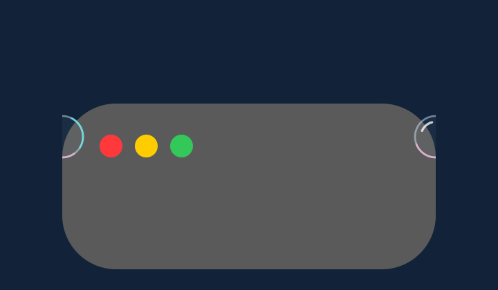
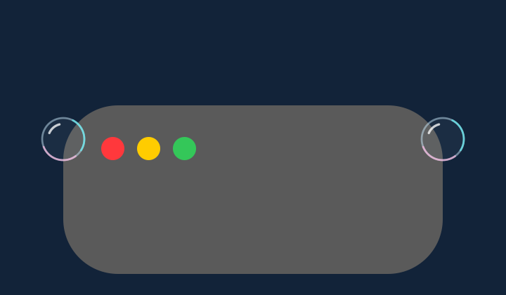

# 비눗방울 창 가장자리 검증

**상태: 2026-11-11 구현·로컬 검증 완료.** 작업 브랜치는 `codex/bubble-edge-overhang`입니다. 공개 버전 1.0.0과 App Store 제출 빌드 15의 배포·서명·설치 상태는 변경하지 않습니다.

## 변경 범위

창의 좌우 끝에 정착한 비눗방울이 누적 영역의 수직 경계에서 잘리는 현상을 다룹니다. `WeatherView`에서 비눗방울 모드의 누적 그리기 영역만 좌우 **14pt**씩 넓힙니다. 최대 지름 20pt인 방울의 반지름과 터질 때 최대 1.22배 확대, 테두리·안티앨리어싱을 위한 여유입니다.

물리 계산·정착 위치·누적 상태와 기존 세로 clipping은 유지합니다. 다른 효과는 가로 여유를 추가하지 않습니다. 넓어진 부분에도 앞 창의 가림, 작업 창 숨김, 앱별 제외 마스크를 적용합니다.

## 검사 정의

| 검사 | 확인할 동작 | 최종 결과 |
| --- | --- | --- |
| 좌우 외곽 | 창의 왼쪽·오른쪽 끝에서 비눗방울의 바깥 부분이 보이는지 확인 | 일반·터짐 모두 통과 |
| 원형 보존 | 일반 상태와 터지는 상태의 외곽을 창 내부의 완전한 비눗방울 참조와 비교 | 30×30 alpha 픽셀 완전 일치 |
| 앞 창 가림 | 기존 누적 폭 바깥에 있는 앞 창도 새로 드러난 부분을 가리는지 확인 | 통과 |
| 여러 창 겹침 | 앞 창 둘이 겹쳐도 가려진 영역이 다시 열리지 않는지 확인 | 통과 |
| 포커스·앱 제외 | 소유 창을 숨기면 경계 밖으로 나온 부분까지 모두 숨기는지 확인 | 신규 검사 및 기존 131개 통과 |
| 다른 일곱 효과 | 동일 입력으로 생성한 변경 전후 PNG를 비교해 비눗방울 외 표시가 유지되는지 확인 | 7개 모두 바이트 일치 |
| 기존 렌더링 회귀 | 곡면·겹침 등 기존 렌더링 검사와 새 가장자리 검사를 함께 실행 | 기존 134개 + 신규 24개, 총 158개 통과 |
| 시뮬레이션·기하 | 기존 SwiftPM Core 테스트 실행 | 98개 통과 |

검사는 AppKit/Core Graphics의 실제 제품 렌더러에 합성 창 geometry와 정착 방울을 전달해 오프스크린 비트맵을 만듭니다. 다른 앱의 화면을 캡처하거나 실제 창을 마우스로 조작하는 검사가 아닙니다. 원형 비교는 양쪽 도형의 절대 좌표를 같게 두고 참조 창을 이동해 수행합니다. 좌표 이동에 따른 미세한 래스터 양자화 차이를 배제하며, 픽셀 허용 오차는 0입니다.

Git 추적 빌드 입력 57개를 `/private/tmp`에 복사해 해시를 확인하고 기존 `script/build_and_run.sh --build-only`로 빌드했습니다. 같은 최종 검사 소스를 사용한 [원래 렌더러 결과](before.json)는 가장자리 관련 12개가 실패했고, [수정 결과](after.json)는 158개 모두 통과했습니다. [포커스 결과](focus.json)와 [비교·입력 해시 기록](comparison.json)을 함께 보관합니다. 테스트 앱은 별도 UserDefaults 도메인을 사용합니다.

| 수정 전 | 수정 후 |
| --- | --- |
|  |  |

두 그림은 같은 최대 지름 20pt의 정착 방울을 3배 크기로 렌더링한 자체 예시입니다. 실제 렌더러 출력이며 수정 후 그림도 별도로 이미지 편집하지 않았습니다. 일반 상태 `life=5`와 터지는 중간 상태 `life=0.2`를 검사했고, 최종 1.22배 확대의 최대 범위는 여유 폭 계산에 반영했습니다.

## 기존 경계와 검증 범위

모니터별 오버레이의 화면 경계는 그대로입니다. 창 끝이 모니터 밖에 있으면 해당 화면 밖의 부분까지 그려 주는 변경이 아니며, 모니터 경계를 넘는 연속 표시를 새로 보장하지 않습니다.

이번 작업에는 버전 증가, 새 패키지 배포·서명·공증, 설치본 교체가 포함되지 않습니다. 실제 데스크톱에서의 시각 확인·물리 입력·모든 모니터 배율 조합은 오프스크린 검사 결과와 구분합니다.
