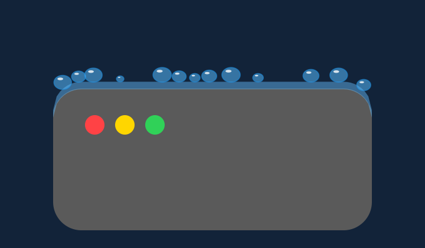
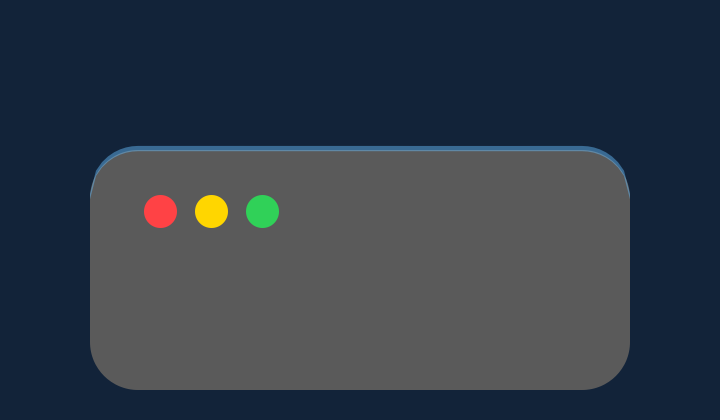

# 비의 얇은 물막 검증

2026-11-13. 개발 소스와 로컬 개발 앱에 반영했습니다. 공개 1.0.0 파일과 기존 설치본을 교체하거나 App Store에 새 빌드를 제출한 작업은 아닙니다.

## 동작

- 물막 상한을 4pt에서 1.5pt로 낮췄습니다. 저장 높이·충돌·화면 간 전달에 같은 상한을 사용합니다.
- 비가 닿을 때 튀는 방울, 창 위에서 합쳐지는 방울, 아래로 떨어지는 큰 방울, 원형 파문을 생성·렌더링하는 경로를 제거했습니다. 사용하지 않는 전용 상태도 제거했습니다.
- 빗줄기의 생성·속도·바람 반응·색·길이·두께·투명도는 변경하지 않았습니다. 눈이 창 이동에 반응해 흩어지는 조각은 유지합니다.
- 누적을 끄면 빗줄기만 보이고 물막은 사라집니다. 물막은 기존처럼 증발하며 창의 곡면과 앞뒤 순서, 포커스·앱 제외 설정을 따릅니다.

## 검증

| 확인 항목 | 결과 |
| --- | --- |
| SwiftPM Core | 98개 통과. 장시간 강우에서도 물막 0…1.5pt, 비 splash 없음, 누적 OFF, 증발·전달·눈 이동 반응 포함 |
| 곡률·겹침·비눗방울·비 렌더링 | 기존 158개 + 물막 관련 5개, 총 163개 통과 |
| 포커스·앱 제외 | 131개 통과 |
| 동일 최종 fixture로 원래 구현 실행 | 163개 중 `rainFilmHasNoPixelsOutsideThinSurfaceBand`만 실패 |
| 낙하하는 비 보존 | 표면 없는 동일 seed 장면의 PNG 전후 바이트 동일 |
| 다른 일곱 효과 보존 | 눈·낙엽·벚꽃·비눗방울·색종이·반딧불·별가루 PNG 전후 바이트 동일 |
| 개발 앱 보관 | 프로젝트 `dist/development/WindowWeather.app`, 빌드 원본과 파일 바이트 일치 및 ad-hoc 서명 검증 통과 |

물막 검사는 20초 동안 비가 내린 뒤 2초간 멈춰 낙하 입자가 사라진 장면을 사용합니다. 물막은 실제로 보여야 하며, 1.5pt 높이와 가장자리 안티앨리어싱을 포함한 3pt 띠 밖에는 픽셀이 없어야 합니다. 비교 이미지는 같은 장면의 창을 반경 16pt로 바꿔 3배 크기로 렌더링했습니다.

장식 생성에 쓰던 난수 소비가 사라져 충돌이 있는 비 장면의 개별 빗줄기 위치는 달라질 수 있습니다. 낙하 표현 자체의 보존 여부는 충돌이 없는 별도 장면으로 확인했습니다. 곡률 이동 테스트의 비 fixture는 새 상한 아래인 1pt를 사용하며, 다른 효과의 기존 3pt fixture와 별도의 물막 상한 검사는 유지했습니다.

| 수정 전 | 수정 후 |
| --- | --- |
|  |  |

[수정 전 결과](before.json), [수정 후 결과](after.json), [포커스 결과](focus.json), [입력·실행 파일·PNG 비교 해시](comparison.json)를 보관했습니다. Git 추적 빌드 입력 57개를 별도 `/private/tmp` 경로에 복사해 확인하고 기존 `script/build_and_run.sh --build-only`를 사용했습니다. 최종 앱과 전체 입력 해시는 로컬 `dist/development/BUILD.json`에도 기록했습니다.

## 범위

그림은 실제 제품의 AppKit 렌더러에 합성 창을 전달해 만든 오프스크린 결과입니다. 실제 다른 앱의 화면 캡처·마우스 조작이나 모든 디스플레이 배율 검증은 수행하지 않았습니다. 개발 앱은 로컬 개발용 서명이며 새 Developer ID 서명·공증 배포본은 아닙니다.
